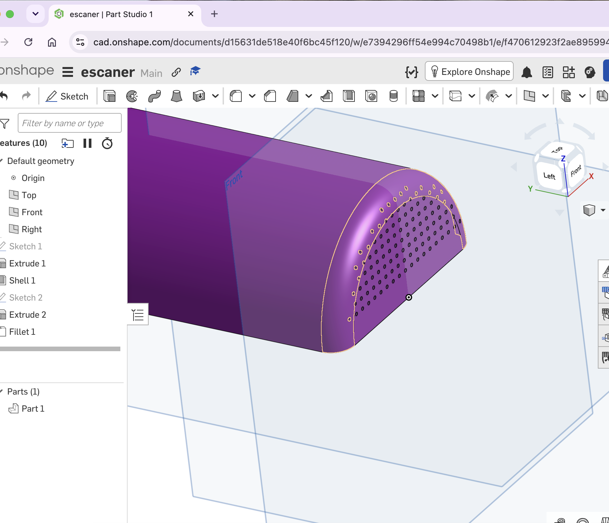
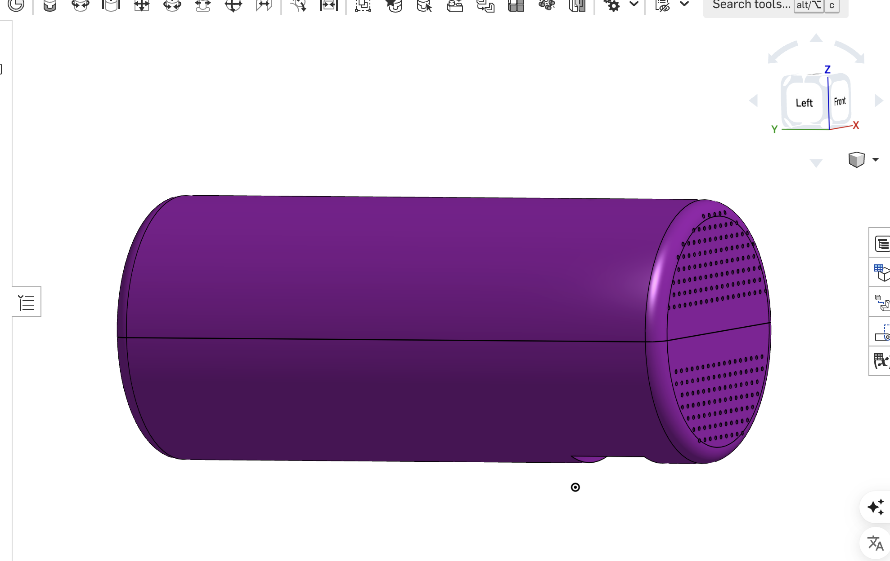

# hello week 11

For this week we have acomplished the final idea for the model as well we were ready to print. After discussing with the TA and the client we came up with better ideas of how we can improved our final model and the presentation of it.

Some of the key points were:

- how this sensor will be displayed and used, this question was very important since we were able to learn and understand better the descision we needed to make. One thing is that how the audience/ people will be using this device so this is why the sensor will be on the bottom part since the way the person will be hold it and use will work of an extension of a hand.

- the meaning of the model, since we wanted to connect this idea to the ceramic beads and the wax cylinder. we stayed with the idea of the cylinder as the main model. we did some chnages by doing it more rounded instead of a falt surface at the bottom, since after some discussions and descisions we learn and undertood that we didn't need that much space to place everything inside. And that we needed to focus more on the design and the meaning and align this to the work.

- the color of the shape and size: after disccusing with Nadia we were able to learn and understand better what she wanted as a desing. She mentionned that we can forget the idea of the straps and instead try to make the model smaller so it can be easy to hold. For the color Nadia mentionned that we can choose and that they really didn't matter which color we used. But at the end we decided to go with purple since this color will align better with the final ceramic piece that will be used for the demostration. 

- For now we have send the model to print as well decide on the color that we want to give.
   The next step will be to test the model after priting and adding the final details.

