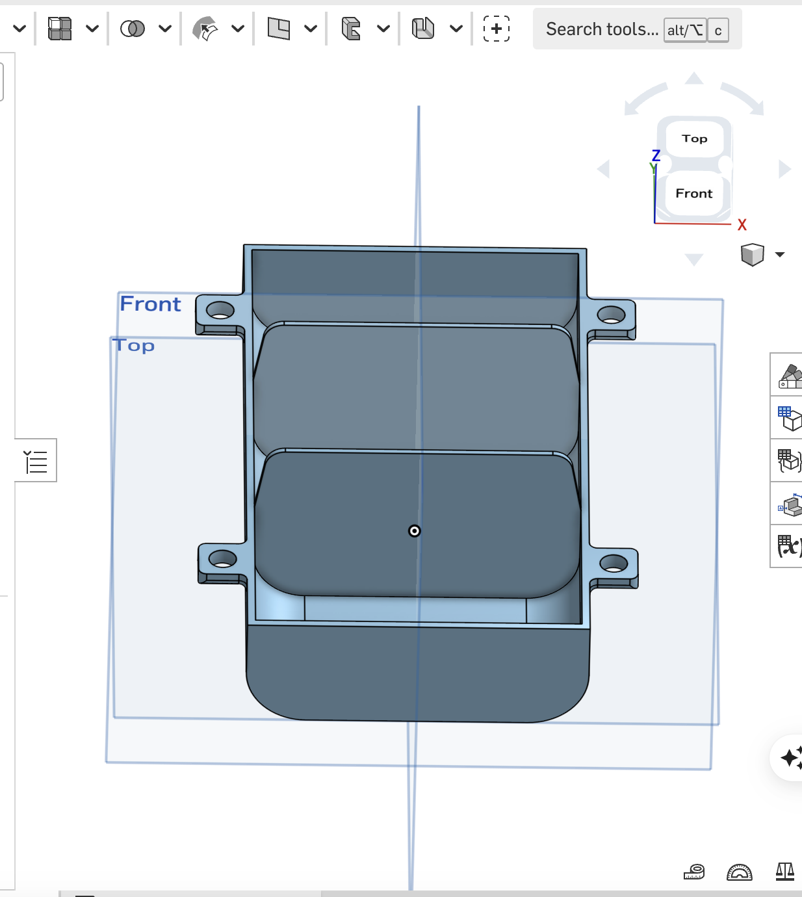
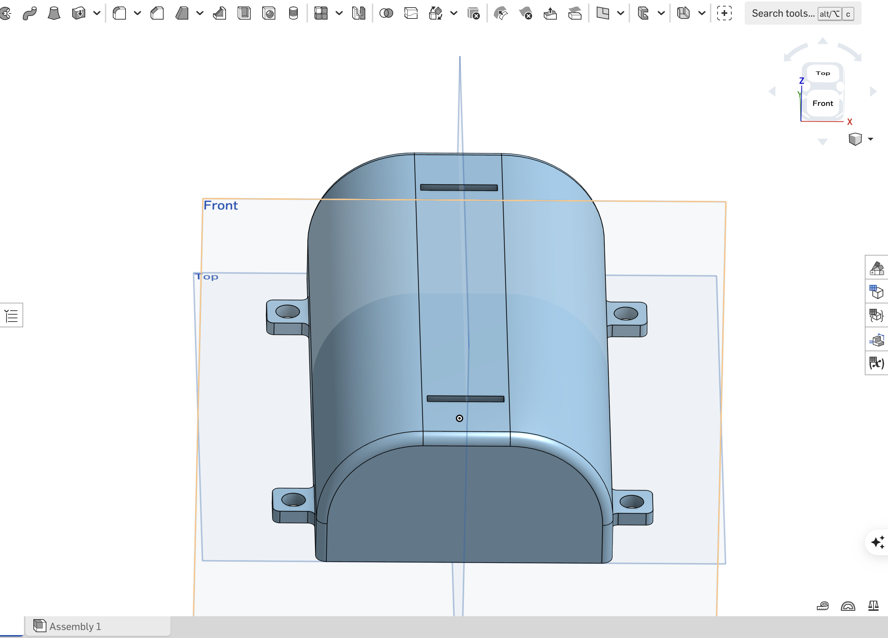

# hello week 9

For this week i did work on different things about the project, after some time of reflection and discussion, Bianca annd I decided to do some 3d cardboard prototypes for testing, and finalize the idea of how the final design will look like. As this is an important part of the art piece and needs to be related with the Nadia's vision. I started to think about ways to incorporte or approach the style that Nadia uses in her work. since her work is ceramic i came up with ideas and did some research on how to make this model continues as an extension and be part of the project:

The 3D model will have be a cylindrical shape, this relates to the idea of the cylinder wax and the ceramic beads, so this is the most secure and similar to what Nadia's is looking for.

The 3D model from the beggining will slightly change but will keep the same idea: Rigth now i did work on a prototype on Onshape but as discussed we want to make look this more cylindrical but at the same time i need to be aware and think always that this is something that someone will be holding. so the more useful option is to incorporate two holes at the bottom so we can pass trough 
a hand strap.

This is for the design 

Now for the things we need to add, to make it easy to hold we were thinking we'are going to use a hand strap, we didn't decide yet where to buy it but i was thinking by maybe doing some diy and try do one by ourselfs. I did got some piece of cloth/ elastic that can be probably used for this part of the project.

Finally, during the last week i did some research for the fiinish looking of the 3d printing since for our first prototype we didn't like the texture and the looking  now we are experimenting to see which color are we going to use or if we are staying with  black . For this i learned about different methods to make it look like ceramic, because this is something that i think can connect with the cermaic beads and the meaning of the project.

the easy option without the need of using a lot of materials is to go with:

sanding + acrylic paint (whatever color) + baking soda + glue or some kind of clear liquid in case we want a more polish and glass feeling of the 3d. For this, i will coninue to do some testing on how this can be done. 

By now my task are: 

- I have an appointment on the digilab to discuss about the project and see if is posisble to be printing by friday
- get a final decision on the color and the outside looking of the 3d model (hopefully by tuesday)
- get together to fit assamble everything.